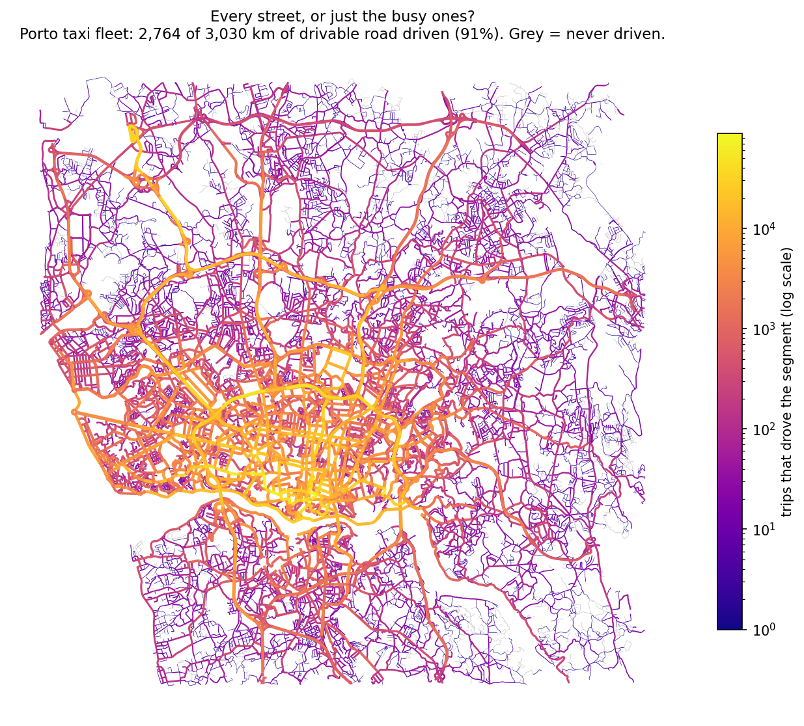

# Every street, or just the busy ones?

Which roads has a fleet really driven? A PySpark pipeline that takes 39 million raw GPS fixes from
Porto's taxi fleet, cleans them, matches each one to the OpenStreetMap road network, and measures
which roads the fleet drives, how often, and which it never touches. The answer: every motorway, but
only about half the residential streets with any regularity. The matching is validated on synthetic
drives where the true route is known.



## Results

Porto taxi data ([ECML/PKDD 2015, UCI](https://archive.ics.uci.edu/dataset/339/taxi+service+trajectory+prediction+challenge+ecml+pkdd+2015)): this run uses the first 800,488 trips of the year-long set, 1 July to 19 December 2013.

| | |
|---|---|
| Trips (after removing 26 duplicate trip IDs) | 800,462 from 439 taxis |
| GPS fixes, one every 15 s | 38,987,770 |
| Outside the study area | 1,115,706 |
| Removed as GPS spikes | 59,187 |
| Matched to a road | 37,359,077 (98.8% of clean fixes) |
| Road network (OpenStreetMap, drivable) | 31,813 segments, 3,030 km |
| **Road driven at least once** | **2,764 km (91%)** |
| Full pipeline on a laptop (12 cores, 32 GB) | 92 s |

Coverage by road class:

| Class | km | Driven | Driven 10+ times |
|---|---:|---:|---:|
| motorway | 181 | 100% | 99.9% |
| primary | 190 | 97% | 96% |
| secondary | 363 | 96% | 91% |
| tertiary | 334 | 97% | 86% |
| residential | 1,632 | 87% | 54% |
| living street | 104 | 94% | 74% |
| unclassified | 54 | 80% | 42% |

Main roads are saturated; the gaps are in residential streets, which is where a data-collection
fleet would need to be sent on purpose.

## How it works

1. **Trips to fixes.** Each trip is one row with its route as a JSON list of coordinates. `from_json` +
   `posexplode` turns 800k trips into 39M timestamped fixes, spread across all cores.
2. **Cleaning.** Duplicate trips are dropped. Fixes outside the study area are removed. A fix is a
   *spike* if the taxi would have had to drive away from it and straight back at an impossible speed,
   while skipping it gives a normal drive; spikes are removed. This needs each trip's fixes in order,
   so it is a window function partitioned by trip, which **shuffles** the data by trip ID.
3. **Matching without a geometric search.** Every road is pre-indexed on the
   [H3](https://h3geo.org) grid at resolution 12 (cells about 9 m across): each cell within about 30 m
   of a road is stored with its distance to that road (1.47M cell–road pairs). Every fix gets its cell,
   so matching is an **equality join on the cell ID**, and each fix keeps the nearest road. A
   continuity step then fixes single odd matches: if the fixes before and after are on the same road,
   the one between them is too.
4. **Coverage.** Per road segment: fixes, trips, taxis, days, first and last seen; then kilometres
   driven per road class.

### Broadcast versus shuffle join

The road index is small (about 6 MB as Parquet) and the GPS side is large, so the road table can be
copied to every executor (broadcast) instead of shuffling both sides by cell ID. Measured on the full run:

| Join strategy | Matching stage | Whole pipeline |
|---|---:|---:|
| Broadcast | 54 s | 92 s |
| Shuffle (sort-merge, broadcast disabled) | 73 s | 111 s |

Same output both ways (37,359,077 matched fixes). Adaptive query execution is on, with skew-join
handling for dense city-centre cells.

## Validation: a test where the answer is known

There are no ground-truth labels for real taxis, so `validate.py` drives 1,575 synthetic trips along
real Porto roads (2–8 km, 22–47 km/h, a fix every 15 s), adds about 6 m of GPS noise, injects 289
large jumps (300 m to 2 km), and runs the same pipeline:

| Measure | Result |
|---|---:|
| Injected spikes removed | 92.7% |
| Good fixes wrongly removed | 0.03% |
| Good fixes matched to some road | 99.9% |
| Matched to the exact segment | 63.6% |
| Exact or adjacent segment | 92.4% |
| **On the correct street** | **95.7%** |

Most "wrong" matches are the next segment of the same road (the median segment is about 140 m long) or the
other carriageway of a divided road. That is the limit of nearest-road matching.

## Next

- **Hidden Markov map matching** (Newson and Krumm, 2009) with heading and one-way rules, to raise
  exact-segment accuracy, measured on the same synthetic set.
- **Where to drive next:** routes over the road graph that cover the most never-driven kilometres.
- The full year of data, coverage by time of day, and the same job on Databricks with Delta tables.

## Run it

Needs Java 17 and Python 3.11.

```
python -m venv .venv && .venv/bin/pip install pyspark==3.5.3 pyarrow==18.1.0 pandas==2.2.3 h3==4.1.2 osmnx==1.9.4 matplotlib==3.9.2
./run.sh                 # downloads the data once, builds the road index once, runs the pipeline, draws the map
./run.sh --sample 0.05   # 5% of trips, about 20 s
.venv/bin/python validate.py --trips 2000
```

Files: `prepare_roads.py` (OpenStreetMap download and H3 road index), `pipeline.py` (the Spark job),
`validate.py` (synthetic drives and scoring), `make_map.py` (the map).

Author: Chann Isaac · [GitHub](https://github.com/devChann) · [LinkedIn](https://www.linkedin.com/in/chann-isaac-19b403145/)
